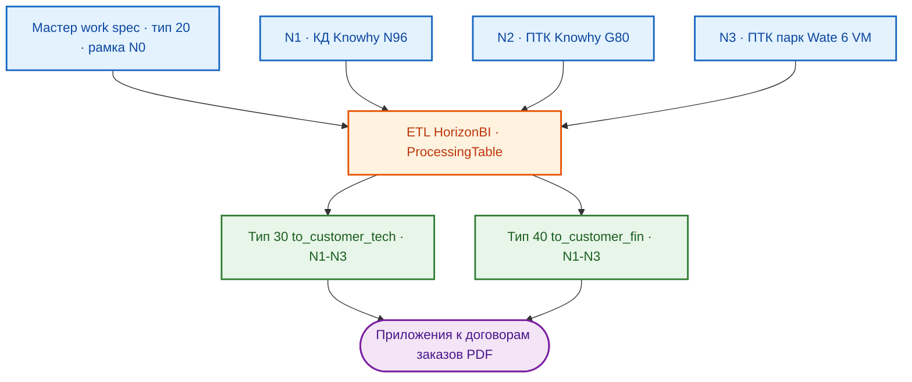
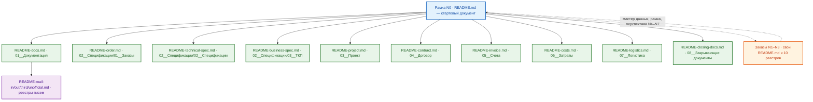

# ПРОЕКТ 8/2026-N0-ГОРИЗОНТ: ВЕНДИНГОВЫЕ АППАРАТЫ — ПИЛОТНАЯ ПАРТИЯ
**Рамочный договор · ООО «ГОРИЗОНТ» (ГК «ПЕРЕДОВЫЕ РЕШЕНИЯ») → ООО «ТМ ТЕХНОЛОГИЯ»**
(заказчик — новое юрлицо ГК заказчика, с 20.10.2026; ранее — ООО «Точные машины»)

> ⚠️ **Важно:** документ — **строго для внутреннего пользования**. Передача
> сотрудникам вне проектной команды и любые внешние копии запрещены: содержит
> внутренние бизнес-процессы, коммерческие механики и статусы переговоров.

---

## ОГЛАВЛЕНИЕ

1. [Введение](#1-введение)
2. [Обзор проекта](#2-обзор-проекта)
3. [Структура ИРП](#3-структура-ирп)
4. [Система спецификаций](#4-система-спецификаций)
5. [Бизнес-механика сделок](#5-бизнес-механика-сделок)
6. [Структура документации проекта](#6-структура-документации-проекта)
7. [Дорожная карта и статус](#7-дорожная-карта-и-статус)
8. [Технологический стек · контакты и реквизиты](#8-технологический-стек--контакты-и-реквизиты)
9. [Иерархия документации и реестров](#9-иерархия-документации-и-реестров)

> **С чего начинать:** документ — точка входа. Далее по типу задачи:
> реестр заказов группы → [`02__Спецификации/01__Заказы/README-order.md`](./02__Спецификации/01__Заказы/README-order.md),
> юридический контур → [`04__Договор/README-contract.md`](./04__Договор/README-contract.md),
> платёжный → [`05__Счета/README-invoice.md`](./05__Счета/README-invoice.md),
> полный перечень разделов — раздел 9.

---

## 1. ВВЕДЕНИЕ

Рамочный договор `8/2026-N0-ГОРИЗОНТ` — базовая сделка для адаптации, разработки,
производства и поставки промышленных вендинговых аппаратов, которые ООО «ГОРИЗОНТ»
изготавливает на базе металлоконструкций китайских производителей **Knowhy** и
**Wate technology** с собственной ПТК **«Horizon VM»**. Конечная цель заказчика —
цифровизация внутрицеховой выдачи инструмента, расходников и СИЗ на площадках
конечного заказчика (атрибутика — закрытая, см. `AGENTS.md` § 1.1 п. 3).

Преемственность: с 2025 года та же связка заказчика и юрлица ГК работала по договору
`27/2025-N0-МАС` (исполнитель — ООО «МАС»). Рамочный договор `8/2026-N0` повторяет
его текст дословно — юридическая экспертиза со стороны заказчика не требуется,
согласование ускоряется (переговорный акцент).

## 2. ОБЗОР ПРОЕКТА



Состав заказов (рамка → прикладные):

| Заказ | Предмет | Позиций | Без НДС, руб | Срок, к.д. | Статус |
| :---: | :--- | :---: | ---: | :---: | :---: |
| N1 | КД доработки металлоконструкции Knowhy N96/master | 8 | 1 807 600 | 164 | готов к контрактованию |
| N2 | Адаптация ПТК Horizon VM, Knowhy G80/master | 5 | 2 960 000 | 120 | границы зафиксированы |
| N3 | Адаптация ПТК, парк Wate technology (6 VM — по Решению №2 от 19.10) | 36 | 19 345 800 (факт) | 210 | мастер `20__work_spec` скорректирован |
| N4–N7 | Перспективные (N4 — металл N96; N5 — объединённый N1+N4 для G80; N6 — объединённые КД+металл+монтаж парка Wate; N7 — исполнительная/эксплуатационная документация парка Wate) | — | ТКП формируется | — | 🎯 инициация |

## 3. СТРУКТУРА ИРП

```text
8_2026-N0-Горизонт\
 01__Документация\        акты, сверки, маркировка, переписка, протоколы, NDA
                          (Протоколы\01__преддоговорные переговоры\ — Отчёт 02.10.2026,
                          Решения №1 (14.10) и №2 (19.10))
 02__Спецификации\
   01__Заказы\            исходные заказы заказчика (docx)
   02__Спецификации\      20__work_spec — МАСТЕР ДАННЫХ (рамка N0)
   03__ТКП\               01__Поставщики, 02__Участники
  03__Проект\              01__ИД, 02__ТЗ, 03__План-график, 04__Документация,
                           журнал ai-*.md, temp\
 04__Договор\             01__В стадии согласования → 02__Согласованный → 03__Подписанный
 05__Счета\ · 06__Затраты\ · 07__Логистика\
 08__Закрывающие документы\ · 09__Подписанные документы\ · 10__Персонал\
```

Прикладные заказы живут в параллельных директориях `..\8_2026-N{1..3}-Горизонт\`
(та же ИРП + производные спецификации 30/40). Каждый каталог верхнего уровня
рамки и заказов имеет свой реестр `README-*.md` — раздел 9. Полный файловый
реестр (срез): `03__Проект/temp/project-inventory.md`.

## 4. СИСТЕМА СПЕЦИФИКАЦИЙ

| Тип | Каталог | Назначение |
| :---: | :--- | :--- |
| 20 | `02__Спецификации/02__Спецификации/20__work_spec` | мастер-данные (единственная точка истины, редактирует инженер) |
| 30 | `…/30__to_customer_tech` (в заказах) | техническое приложение к договору, без цен |
| 40 | `…/40__to_customer_fin` (в заказах) | коммерческое приложение: цены реализации, НДС 22%, чистая база |
| 50–90 | `…/{50..90}__*` | from_customer / to_supplier / from_supplier / purchase / shipment (зарезервированы) |

**→ Регламент системы спецификаций**: [AGENTS.md](./AGENTS.md) § 3.
Ключ позиции во всей экосистеме — `HASH COLLECTION`; в выходные документы попадают
только `isSHIPPED = "true"` и старшая `VER COLLECTION`; скрытые правки — по
`isPROCESSING = "true"`.

## 5. БИЗНЕС-МЕХАНИКА СДЕЛОК

Внутренний смысл условий, согласованных на митапе 02.10.2026 (детали — в отчете):

- **Авансовая механика** строится вокруг закупочного цикла: в N3 авансы 1 и 2
  запускают закупки двух половин заказа, аванс 3 — продолжение работ,
  постоплата — процентование по каждому экземпляру аппарата;
- **Консалтинг N3** (выездная приемка ТМЦ у `Wate technology`, 199 500 без НДС)
  встроен в каждую модель позицией `3.x04.1` — закрывает риск брака на приемке;
- **Границы ответственности исполнителя**: во всех заказах КД/ЭД/металлоконструкции
  вынесены за рамки (N4–N7) — не «упущено», а зафиксировано договором;
- Проценты авансов — ориентировочные доли для заказчика; в ТКП — только абсолютные
  суммы (баланс проверяется по строке «Итог» спецификации).

## 6. СТРУКТУРА ДОКУМЕНТАЦИИ ПРОЕКТА

### Подписанный пакет (рамка `8/2026-N0`):
- 📑 [Договор rev.01 v02 — подписанная версия (pdf, ЭДО)](./04__Договор/03__Подписанный/01__Договор/Договор-ТМ%20Технология%20-%20Горизонт%20rev.01%20v02%20%2308_2026%20sign.pdf)
- 📑 Подписанные приложения: `04__Договор\03__Подписанный\02__Приложения\Приложения к договору №8_2026-N0-Горизонт от 20.10.26.pdf`
- 📄 [Договор — наша редакция v01 (docx)](./04__Договор/01__В%20стадии%20согласования/01__Договор/Договор-Точные%20машины%20-%20Горизонт%20rev.01%20v01%20%2308_2026.docx)
- 📑 [Сверка v01↔v02: юридически значимые правки](./04__Договор/01__В%20стадии%20согласования/Сверка/01__Отчет-сверка-v01-v02%20-%20юридически%20значимые%20правки%20-%2020.10.2026.md) ·
  [текстовые правки](./04__Договор/01__В%20стадии%20согласования/Сверка/02__Отчет-сверка-v01-v02%20-%20текстовые%20правки%20-%2020.10.2026.md)

### Для пользователей:
- 💰 [Отчет преддоговорных переговоров](./01__Документация/Протоколы/01__преддоговорные%20переговоры/01__Отчет-преддоговорные%20переговоры%20-%202.10.2026.md)
- 🤝 [Решение №1 заказчика по переговорам (14.10.2026)](./01__Документация/Протоколы/01__преддоговорные%20переговоры/02__Решение-N1%20-%20преддоговорные%20переговоры%20-%2014.10.2026.md)
- 🤝 [Решение №2 заказчика: состав моделей N3 (19.10.2026)](./01__Документация/Протоколы/01__преддоговорные%20переговоры/03__Решение-N2%20-%20преддоговорные%20переговоры%20-%2019.10.2026.md)
- 🧾 [Реестр корректировок старта проекта (договор + N1–N3)](./01__Документация/Корректировки/01__Старт-проекта/Отчет-корректировки%20-%20старт%20проекта%20%28заказы%201,2,3%29.md)
- 📽 [Презентация вводного совещания (22.10.2026)](./01__Документация/Митапы-внутренние/01__митап-N1-вводный-22.10.2026/Презентация-вводное-совещание%20-%2022.10.2026.md)
- 📘 [Манифест AGENTS.md](./AGENTS.md)

### Реестры разделов (иерархия документации — раздел 9):
- 🗂 [01__Документация → README-docs.md](./01__Документация/README-docs.md)
- 🗂 [02__Спецификации/01__Заказы → README-order.md](./02__Спецификации/01__Заказы/README-order.md) ·
  [02__Спецификации → README-technical-spec.md](./02__Спецификации/02__Спецификации/README-technical-spec.md) ·
  [03__ТКП → README-business-spec.md](./02__Спецификации/03__ТКП/README-business-spec.md)
- 🗂 [03__Проект → README-project.md](./03__Проект/README-project.md) ·
  [04__Договор → README-contract.md](./04__Договор/README-contract.md)
- 🗂 [05__Счета → README-invoice.md](./05__Счета/README-invoice.md) ·
  [06__Затраты → README-costs.md](./06__Затраты/README-costs.md) ·
  [07__Логистика → README-logistics.md](./07__Логистика/README-logistics.md) ·
  [08__Закрывающие документы → README-closing-docs.md](./08__Закрывающие%20документы/README-closing-docs.md)

### Для команды:
- 📄 Спецификации тип 40 (финансовые) и 30 (технические) — в каталогах заказов N1–N3,
  реестр производных — [README-technical-spec.md](./02__Спецификации/02__Спецификации/README-technical-spec.md)
- 📚 Стартовые документы заказов: [N1](../8_2026-N1-Горизонт/README.md) ·
  [N2](../8_2026-N2-Горизонт/README.md) · [N3](../8_2026-N3-Горизонт/README.md)
- 📘 Манифест и регламенты — [AGENTS.md](./AGENTS.md)

### Рабочие документы:
- 🔧 Журнал проекта — [ai-8_2026-n0-горизонт.md](./03__Проект/ai-8_2026-n0-горизонт.md)
- 🔧 Журналы заказов (с 20.10.2026 работа в ИРП заказов):
  `..\8_2026-N1-Горизонт\03__Проект\ai-8_2026-n1-горизонт.md` ·
  `..\8_2026-N2-Горизонт\03__Проект\ai-8_2026-n2-горизонт.md` ·
  `..\8_2026-N3-Горизонт\03__Проект\ai-8_2026-n3-горизонт.md`
  (переходные промты — `03__Проект\00__raw\ai-trans-order{1..3}.md`)
- 🔧 План-график N2 — в `..\8_2026-N2-Горизонт\03__Проект\03__План-график\`

## 7. ДОРОЖНАЯ КАРТА И СТАТУС

- ✅ 05.10.2026 — системный контекст, реестр, отчет по митапу (промты 0.1/1.1)
- ✅ 05.10.2026 — git рамки инициализирован, стартовый коммит в GitHub
- ✅ 05–08.10.2026 — отчет актуализирован промтами 1.2–1.6 до v1.4: условия оплаты,
  итоги/длительности, варианты очерёдности старта N1–N3, авансные схемы N3,
  реестр перспективных заказов N4–N7
- ✅ 08.10.2026 — собственный детерминированный PDF-конвейер отчета
  (`03__Проект\tools\make-pdf.cmd`): Playwright/Edge, закладки, нумерация страниц
- ✅ 14.10.2026 — отчет перенесен в постоянное хранение
  (`01__Документация\Протоколы\01__преддоговорные переговоры\`), конвейер перенастроен
- 🤝 14.10.2026 — **Решение №1 заказчика**: запуск N1/N2 (ТКП до 16.10, авансы 70% / 55%);
  N3 — отсрочка 30 дней, основание — совместный выезд на завод WATE 19–31.10.2026
- 🤝 19.10.2026 — **Решение №2 заказчика** (по итогам встречи 15.10): перечень N3 —
  **6 моделей** (`G24P` вместо `L8050 stand-alone`, `C100 (slave)` вместо `C80/master`,
  `C80/slave` выведена); подписание N1/N2/N3 одновременное; N3 — схема 6.3.2
  (разбитый аванс, отсрочка 1-го платежа месяц, 210 к.д.); аудит на WATE отменён →
  техмитап (10–15 вопросов) + выездная приёмка; G24P — 3 600 000,00 ₽ без НДС;
  прогноз N3 — 19 342 500,00 ₽ без НДС (36 позиций); приглашение в ЭДО
- 🤝 20.10.2026 — **смена контрагента**: договор через ЭДО прислан от **ООО «ТМ ТЕХНОЛОГИЯ»**
  (новое юрлицо ГК заказчика, новый директор-подписант; все заказы N1–N7 — для него).
  Версия заказчика — **rev.01 v02** (pdf, ЭП). Сверка v01↔v02 выполнена
  (`04__Договор\01__В стадии согласования\02__Сверка\`): статьи 1–33 дословно идентичны;
  блокер — битые банковские реквизиты заказчика в v02 (к/с 19 зн., БИК 8 зн.) + дата
  «01» сентября 2026; готовится ответ заказчику
- ✅ 20.10.2026 — **рамочный договор 8/2026-N0 подписан исполнителем** через ЭДО
  (версия заказчика `rev.01 v02` подписана ЭП заказчика 20.10.2026; сверка v01↔v02 —
  `04__Договор\01__В стадии согласования\02__Сверка\`, существенных правок в статьях нет;
  зафиксированы расхождения: банк-реквизиты заказчика в v02, дата договора —
  устраняются перепиской)
- ✅ 20.10.2026 — **работа по заказам перенесена в ИРП N1–N3**: переходные промты
  `..\8_2026-N{n}-Горизонт\03__Проект\00__raw\ai-trans-order{n}.md` + журналы заказов
  `03__Проект\ai-8_2026-n{n}-горизонт.md` (n = 1, 2, 3)
- 🔄 Корректировка `20__work_spec` по Решению №2 завершена (ведёт ответственный инженер):
  фактические итоги N3 — **19 345 800,00 без НДС** (НДС 4 256 076,00; с НДС 23 601 876,00),
  36 позиций; схема авансов «Вариант D» (с НДС): 6 710 000 / 6 710 000 / 7 376 120 /
  243 756 / постоплата 2 562 000
- ✅ 21.10.2026 — **единый реестр корректировок старта** (договор + Спецификации № 1/№ 3):
  `01__Документация\Корректировки\01__Старт-проекта\` — урегулирование одним письмом
  заказчику (план 26.10.2026)
- ✅ 22.10.2026 — **вводное совещание по старту N1** и презентация портфеля:
  `01__Документация\Митапы-внутренние\01__митап-N1-вводный-22.10.2026\`
- ✅ 26.10.2026 — исходящие письма заказов: N1 — Исх. № M1 «О старте работ» и
  № M2 «Уточнение модели шкафа» (У.4), N2 — Исх. № M1 «О старте работ»; канал ЭДО
- ✅ 27.10.2026 — N3: **письмо-протокол разногласий** (Исх. № M1) направлено через ЭДО
  с Спецификацией № 3 rev.02 v02 (У.1 — статус полнофункционального прототипа,
  У.2 — РИД только ПО уровня `User space`); ожидается реакция стороны заказчика
- ✅ 02.11.2026 — **введена иерархия документации**: реестры `README-*.md` рамки (10)
  и заказов N1–N3 (30) + переработаны стартовые `README.md` (раздел 9)
- 🎯 Обновленные заказы N1/N2/N3 → одновременное подписание через ЭДО; счета на авансы
  (N1 70%, N2 55%, N3 — «Вариант D»)
- 🎯 Список вопросов (10–15 шт.) для техмитапа с WATE — после подписания заказов
- 🎯 Актуализация отчета (v1.5): N3 — 6 моделей, финсводка — после пересчета типа 40
- 🎯 Эскалации инженеру: опечатка «производител», порядок `1.102.1` (раздел 9 отчета)

## 8. ТЕХНОЛОГИЧЕСКИЙ СТЕК · КОНТАКТЫ И РЕКВИЗИТЫ

- **Стек данных:** Excel-смарт-таблицы + Power Query (M), ETL `ProcessingTable`,
  DSL-конфигурации HorizonBI (`IDconfig`);
- **Генерация PDF отчета:** собственный конвейер `03__Проект\tools\md_to_pdf.py`
  (markdown-it → Playwright/Edge → pypdf; закладки, нумерация, страж таблиц);
  MPE — только редактор-предпросмотр; регламент — `AGENTS.md` § 6;
- **Документооборот:** DOCX/XLSX/PDF в OneDrive, git + GitHub (`Konkery/Project-8_2026-N0-HORIZON`);
- **Реквизиты исполнителя:** ООО «ГОРИЗОНТ», ОСНО, НДС 22% (полные реквизиты —
  в шапке рамочного договора);
- **Контактный контур:** коммерческий контур исполнителя (ООО «ГОРИЗОНТ»),
  инженер (мастер и ETL),
  конструкторы и контрагенты (см. `03__Проект/77__Контрагенты/` в заказах).

---

## 9. ИЕРАХИЯ ДОКУМЕНТАЦИИ И РЕЕСТРОВ

### 9.1. Модель



### 9.2. Правила иерархии

| Уровень | Документ | Что содержит | Чего не содержит |
| :--- | :--- | :--- | :--- |
| 0 | корневой `README.md` проекта | назначение, состав, статус, навигация по реестрам | реестровые строки, детали документов |
| 1 | `README-*.md` каталога | реестр (таблица) + краткие комментарии по каждому пункту + связи | дубли полных текстов документов |
| 2 | `README-mail-*.md` каталога `Переписка\` | **единственный** учёт писем: дата, Исх. №, тема дословно, контрагент, статус | — сведения не выносятся вверх, кроме пути к реестру |
| 3 | файл-артефакт (pdf/docx/xlsx/md) | сам документ | — путь указывается копированием (backticks) |

- **Рамка** ведёт реестры на уровне **сводки и статистики** (вся группа N1–N7,
  глобальные показатели, перспектива); **заказ** — подробный жизненный цикл
  своего заказа со ссылкой на рамку.
- Обязанность агента: при каждом изменении файлов проекта **предлагать обновление
  релевантного реестра** (новая строка / статус / комментарий) — см. `AGENTS.md` § 1.2.
- Порядок чтения задачи: корневой `README.md` проекта → реестр раздела → файл-артефакт.

### 9.3. Реестр реестров (рамка N0)

| № | Каталог | Реестр | Предмет реестра | Строк |
| :--: | :--- | :--- | :--- | :--: |
| 1 | `01__Документация\` | [README-docs.md](./01__Документация/README-docs.md) | протоколы и решения сторон, корректировки, митапы, каталоги раздела | 5 + 5 |
| 2 | `02__Спецификации\01__Заказы\` | [README-order.md](./02__Спецификации/01__Заказы/README-order.md) | заказы N1–N7, глобальные показатели портфеля, исходные файлы | 7 |
| 3 | `02__Спецификации\02__Спецификации\` | [README-technical-spec.md](./02__Спецификации/02__Спецификации/README-technical-spec.md) | мастер тип 20, производные 30/40, типы экосистемы | 3 + 6 |
| 4 | `02__Спецификации\03__ТКП\` | [README-business-spec.md](./02__Спецификации/03__ТКП/README-business-spec.md) | выпуски ТКП по группе, сверки редакций, поставщики | 5 + 4 |
| 5 | `03__Проект\` | [README-project.md](./03__Проект/README-project.md) | этапы рамки, артефакты, журналы заказов | 8 + 6 |
| 6 | `04__Договор\` | [README-contract.md](./04__Договор/README-contract.md) | экземпляры договора, приложения, сверки, расхождения | 5 + 3 |
| 7 | `05__Счета\` | [README-invoice.md](./05__Счета/README-invoice.md) | сводка счетов по группе, архивные выпуски, входящие | 10 + 2 |
| 8 | `06__Затраты\` | [README-costs.md](./06__Затраты/README-costs.md) | затраты рамки, каталоги раздела | 3 + 5 |
| 9 | `07__Логистика\` | [README-logistics.md](./07__Логистика/README-logistics.md) | отправки, плановые операции портфеля | 0 + 4 |
| 10 | `08__Закрывающие документы\` | [README-closing-docs.md](./08__Закрывающие%20документы/README-closing-docs.md) | закрывающие документы, схема закрытия по заказам | 0 + 4 |

### 9.4. Стартовые документы прикладных заказов

| Заказ | Корневой `README.md` | Реестры заказа |
| :---: | :--- | :--- |
| N1 | [`../8_2026-N1-Горизонт/README.md`](../8_2026-N1-Горизонт/README.md) | 10 `README-*.md` по той же схеме |
| N2 | [`../8_2026-N2-Горизонт/README.md`](../8_2026-N2-Горизонт/README.md) | 10 `README-*.md` по той же схеме |
| N3 | [`../8_2026-N3-Горизонт/README.md`](../8_2026-N3-Горизонт/README.md) | 10 `README-*.md` + 4 реестра писем |

> ⚠️ **Важно:** реестры `09__Подписанные документы\` и `10__Персонал\` не заведены
> (решение стороны исполнителя от 02.11.2026) — вводятся при появлении содержимого;
> подписанные экземпляры текущего периода — `04__Договор\03__Подписанный\`.

---
**Версия документации:** 1.9 (иерархия документации: реестры `README-*.md` и стартовые
`README.md`; подписанный пакет и события 21.10–02.11.2026; исправлены пути отчётов
сверки — `01__В стадии согласования\Сверка\`)
**Дата актуализации:** 02 ноября 2026 г.
